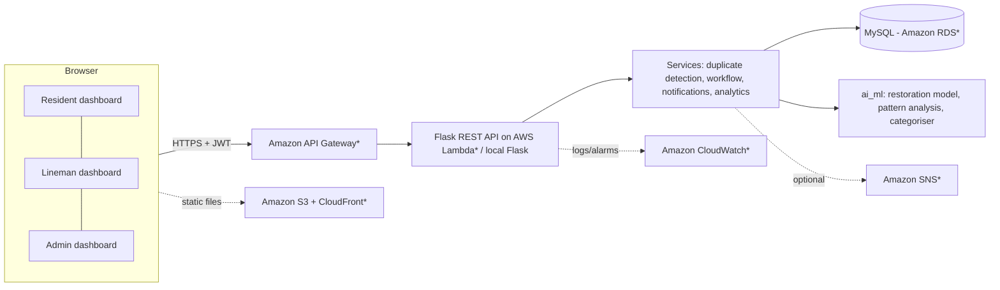
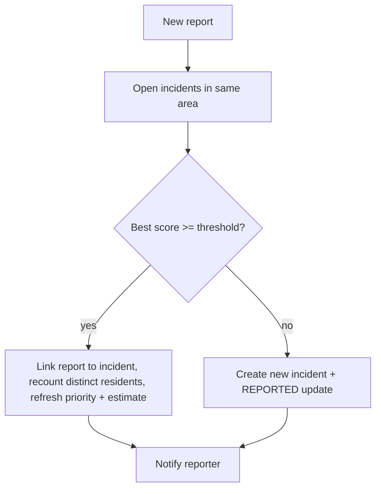
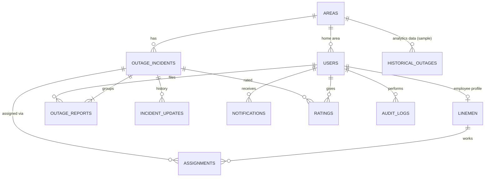

# UrjaSense AI - architecture and ER diagram

## System architecture (local run and AWS target)

\* AWS parts are configuration only (`aws/`); they are not deployed from this repository.

## Duplicate detection (score = proximity 0.5 + time 0.3 + issue 0.2, link when >= 0.55)

## Entity relationships

